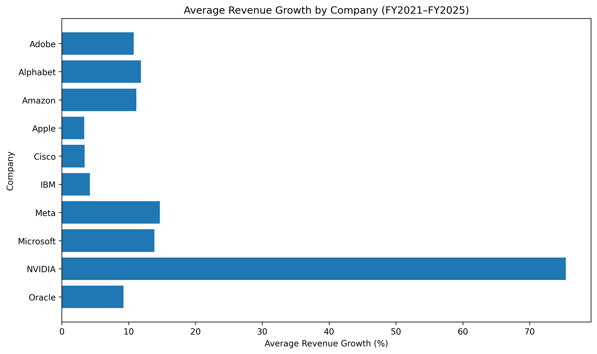
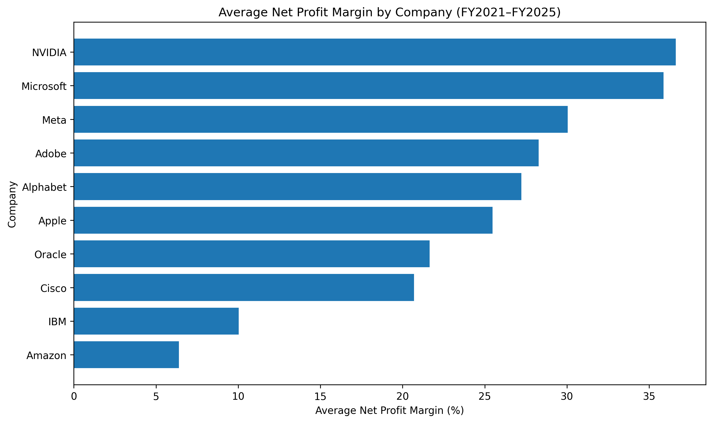
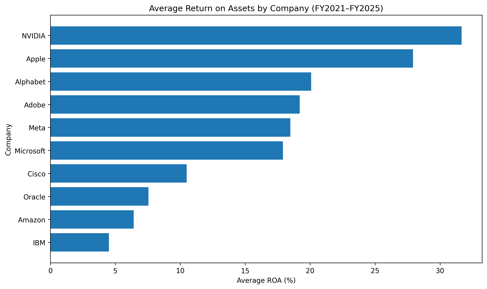
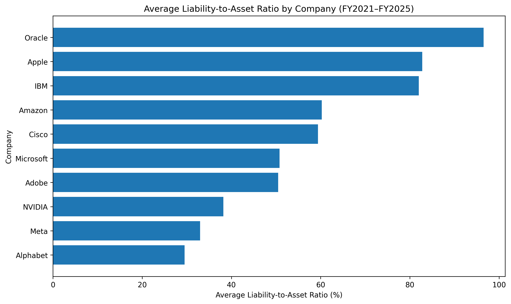
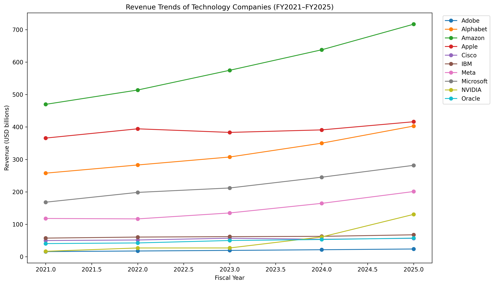
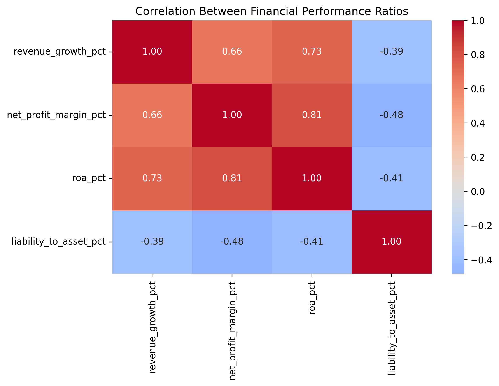
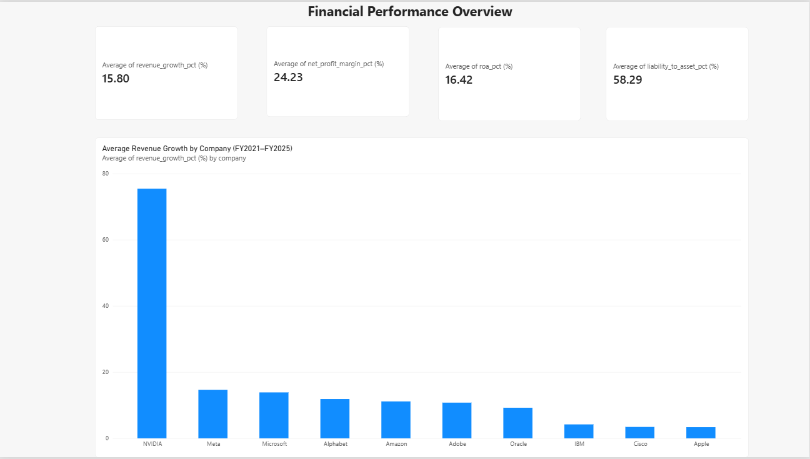
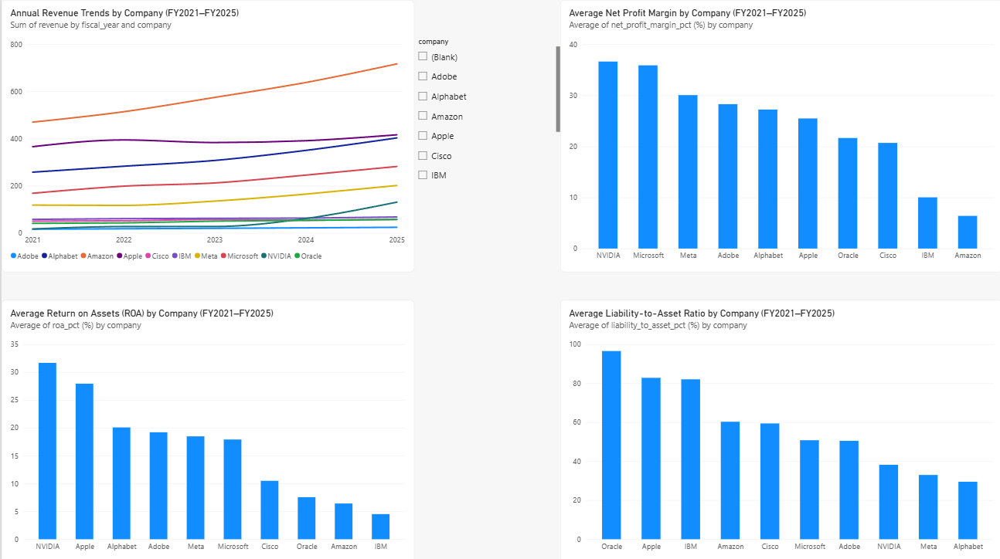
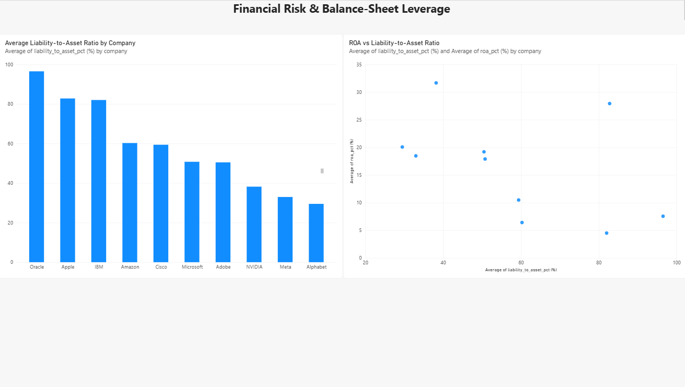

# Financial Performance Analysis of Leading Technology Companies (FY2021–FY2025)

## Project Overview

This project analyzes the financial performance of ten leading technology companies over fiscal years 2021–2025. It examines revenue growth, profitability, return on assets, and financial leverage using publicly available financial data from the U.S. Securities and Exchange Commission (SEC).

The project demonstrates an end-to-end financial analysis workflow using Python, SQL, Excel, and Power BI.

## Research Question

How did the financial performance of major technology companies change from FY2021 to FY2025, and what do their growth, profitability, and financial-risk ratios reveal about their performance?

## Companies Analyzed

- Adobe (ADBE)
- Alphabet (GOOGL)
- Amazon (AMZN)
- Apple (AAPL)
- Cisco (CSCO)
- IBM (IBM)
- Meta Platforms (META)
- Microsoft (MSFT)
- NVIDIA (NVDA)
- Oracle (ORCL)

## Key Metrics

- **Revenue Growth (%)** — year-over-year change in revenue.
- **Net Profit Margin (%)** — net income divided by revenue.
- **Return on Assets (ROA, %)** — net income divided by year-end total assets.
- **Liability-to-Asset Ratio (%)** — total liabilities divided by total assets.

## Tools Used

- **Python:** Data preparation, financial ratio calculations, descriptive statistics, and visualizations.
- **SQL:** Financial data queries, company comparisons, and year-over-year revenue analysis using a window function.
- **Microsoft Excel:** Financial analysis, summary calculations, charts, and dashboard.
- **Power BI:** Interactive dashboard covering financial overview, growth and profitability, and financial risk.

## Key Findings

- NVIDIA recorded the highest average revenue growth, net profit margin, and return on assets in the sample.
- Microsoft demonstrated a high average net profit margin.
- Oracle had the highest average liability-to-asset ratio.
- The correlation analysis identified associations among growth, profitability, asset returns, and financial leverage. These correlations do not establish causation.

## Repository Contents

- `technology_companies_financial_analysis_2021_2025.csv` — cleaned financial dataset.
- `technology_companies_financial_analysis.sql` — SQL analysis queries.
- `Technology_Companies_Financial_Analysis.xlsx` — Excel analysis and dashboard.
- Python notebook (`.ipynb`) — data preparation, analysis, and charts.
- `Technology_Companies_Financial_Analysis_Report.docx` — written project report.

## Methodology

Financial data was collected from the SEC Company Facts dataset. Financial ratios were calculated from reported company data. Each company's fiscal years were retained as reported; fiscal year-end dates were not standardized to calendar years.

The analysis uses descriptive statistics, trend comparisons, and correlation analysis. The sample contains ten companies over five fiscal years.

## Limitations

- The analysis covers a limited sample of ten technology companies.
- Fiscal year-end dates differ among companies.
- Business models and accounting characteristics can affect comparisons.
- Correlation indicates association, not causation.

## Data Source

U.S. Securities and Exchange Commission (SEC), Company Facts data: https://www.sec.gov/edgar/sec-api-documentation

## Disclaimer

This project is for educational and analytical purposes only. It is not investment advice.

## Visualizations

### Python Analysis Charts

#### 1. Average Revenue Growth by Company

#### 2. Average Net Profit Margin

#### 3. Average Return on Assets (ROA)

#### 4. Average Liability-to-Asset Ratio

#### 5. Revenue Trends (FY2021–FY2025)

#### 6. Correlation Heatmap

### Power BI Dashboard

#### Financial Overview

#### Growth & Profitability

#### Financial Risk

